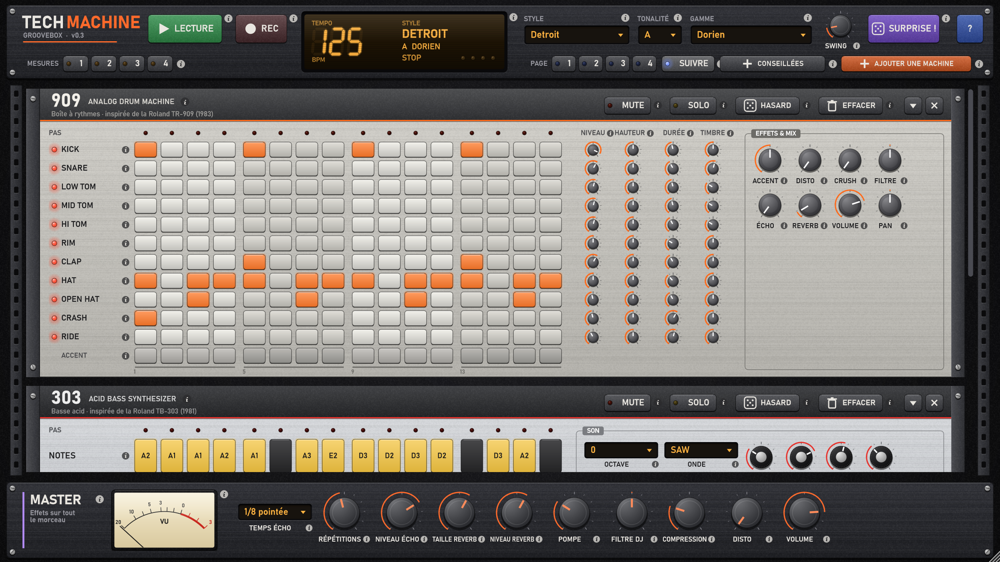

# Tech Machine

Une groovebox pour faire de la musique électronique sans rien y connaître : techno, house, trance, drum & bass,
mais aussi hip-hop, trap, lo-fi, funk, disco, reggaeton, afro, reggae, synthwave, pop, ambient…
50 instruments recréés par synthèse (et un sampler pour tes propres sons), un séquenceur pas à pas et un piano roll,
plus de 430 sons célèbres prêts à jouer, une bibliothèque de rythmes, le clavier MIDI, et une explication derrière
chaque bouton, en français ou en anglais.



## Télécharger

Va dans [Releases](../../releases/latest) et prends :

- **TechMachine-Windows-Standalone.zip** : l'application seule. Dézippe et lance `Tech Machine.exe`.
- **TechMachine-Windows-VST3.zip** : le plugin pour ton logiciel de musique (Ableton, FL Studio, Reaper, Bitwig…).
  Dézippe et copie le dossier `Tech Machine.vst3` dans `C:\Program Files\Common Files\VST3`, puis relance un scan des plugins.

Windows 10/11 64 bits. L'exe n'est pas signé : au premier lancement, Windows SmartScreen peut afficher
« Windows a protégé votre ordinateur » → « Informations complémentaires » → « Exécuter quand même ».

**Sur Mac** (macOS 11 ou plus récent, Intel ou Apple Silicon) :

- **TechMachine-macOS-Standalone.zip** : dézippe et glisse `Tech Machine.app` dans Applications.
- **TechMachine-macOS-VST3.zip** : copie `Tech Machine.vst3` dans `~/Library/Audio/Plug-Ins/VST3`.
- **TechMachine-macOS-AU.zip** (Logic Pro, GarageBand) : copie `Tech Machine.component` dans `~/Library/Audio/Plug-Ins/Components`.

L'app n'est pas notarisée par Apple : au premier lancement, fais clic droit sur l'app → « Ouvrir ».
Si macOS dit qu'elle est « endommagée », tape une fois dans le Terminal :
`xattr -dr com.apple.quarantine "/Applications/Tech Machine.app"` (même chose pour les plugins, avec leur chemin).

## Les machines

Chaque machine est entièrement synthétisée (aucun sample) en imitant les circuits des originaux.

| Machine | Inspirée de | Pour quoi faire |
|---|---|---|
| **909** | Boîte à rythmes Roland TR-909 (1983) | Le son techno / house : kick, snare, 3 toms, rim, clap, hats et cymbales au grain 6 bits |
| **808** | Boîte à rythmes Roland TR-808 (1980) | Kick « boom », cowbell, claves, maracas : électro, Detroit |
| **Break Kit** | Breakbeats samplés (E-mu SP-1200) | Batterie acoustique lo-fi pour la jungle, la drum & bass, le breakbeat |
| **303** | Roland TB-303 (1981) | Lignes de basse acid : filtre résonant, accent, slide |
| **101** | Roland SH-101 (1982) | Basses et leads : saw, square + PWM, sub, bruit, ADSR, glide |
| **D-Bass** | Minimoog Model D (1970) | Grosses basses, sub, basse « Reese » de la drum & bass |
| **106** | Roland Juno-106 (1984) | Accords et nappes avec le fameux chorus |
| **8000** | Roland JP-8000 (1996) | Supersaw de la trance, en accords ou en lead |
| **Linn** | LinnDrum (1982) | Batterie 80s samplée : pop, funk, synthwave |
| **CR-78** | Roland CR-78 (1978) | Boîte rétro douce, guiro, bongos : lo-fi, pop |
| **MPC Kit** | Samplers MPC / SP-1200 | Kit boom bap au grain 12 bits, finger snap |
| **Percussions** | Percussions latines et africaines | Congas, bongos, timbales, agogo, guiro, triangle, claves |
| **FX** | — | Riser, downlifter, impact, sweep, laser, sirène dub, air horn, vinyle, cymbale inversée |
| **808 Sub** | Basse 808 | La basse glissée du trap, de la drill et du reggaeton |
| **DX7** | Yamaha DX7 (1983) | FM : piano électrique, basse FM, cloche, cuivres, marimba, nappe |
| **Strings** | ARP Solina (1974) | Nappes de cordes avec chorus d'ensemble |
| **Organ** | Hammond B3 / orgue house M1 | Orgue à tirettes avec Leslie, ou orgue house percussif |
| **Piano** | Piano acoustique | À queue, droit, bastringue, pop brillant, feutré |
| **Mallets** | Percussions mélodiques | Glockenspiel, vibraphone, célesta, boîte à musique, kalimba, steel drum, cloches, marimba |
| **Pluck** | Cordes pincées (synthèse physique) | Guitare acoustique, nylon, funk, harpe, koto, sitar, pizzicato |
| **Choir** | Chœurs | Voix « aah », « ooh », « eeh », « mmh », hommes, femmes, grégorien |
| **707 / 727** | Roland TR-707 / TR-727 (1985) | House de Chicago, percussions latines |
| **Drum Kit** | Batterie acoustique | Rock, pop, soul, jazz : ghost notes, cross-stick, ride bell |
| **Simmons** | Simmons SDS-V (1981) | Toms électroniques « piou » des années 80 |
| **World Perc** | Percussions du monde | Tabla, darbouka, djembé, talking drum, taiko, cajón |
| **Sampler** | — | Tes propres sons sur 8 pads, découpe de boucle façon MPC |
| **Bass** | Basse électrique | Aux doigts, slap, médiator, fretless, contrebasse |
| **Wobble** | Basses dubstep / drum & bass | Wobble calé sur le tempo, Reese, Growl |
| **Hoover** | Roland Alpha Juno (1985) | Le hoover de la rave et du gabber |
| **Poly 80s** | Prophet-5, OB-X, Jupiter-8, Polysix, JX-3P, OB-6, Prophet-6, minilogue, PolyBrute | 8 modèles : cuivres « Jump », nappes synthwave, accords 80s |
| **M1** | Korg M1 (1988) | Piano house, orgue, nappes Lore et Universe |
| **EDM** | Supersaw moderne | Accords future bass avec sidechain intégré, plucks |
| **Talkbox** | Talkbox | Le synthé qui parle du G-funk et de Daft Punk |
| **Mellotron** | Mellotron | Flûtes, cordes, chœurs sur bandes magnétiques |
| **E.Piano** | Rhodes, Wurlitzer, Clavinet | Pianos électriques soul, funk, lo-fi, et clavecin |
| **Brass** | Cuivres | Trompette, trombone, sax, section funk, stabs |
| **Winds** | Bois | Flûte, flûte de pan, clarinette, shakuhachi, ocarina, flûte trap |
| **Orchestra** | Orchestre | Cordes, pizzicato, orch hit, timbales, harpe |
| **606** | Roland TR-606 (1981) | La petite sœur de la 808 : acid, électro minimaliste, EBM |
| **Rhythm Box** | Wurlitzer Side Man, Rhythm Ace, Donca-Matic | Les premières boîtes à rythmes : douces et rétro |
| **Digital Kit** | Roland TR-505 / TR-626, Alesis SR-16 | Boîtes numériques granuleuses de la fin des années 80 |
| **Synth Drums** | Korg ER-1, Elektron Machinedrum / Syntakt | Percussions FM et en anneau : bips, clangs, zaps |
| **8-Bit** | Puce SID (Commodore 64), SidStation | Chiptune : carrés, triangle en escalier, arpèges ultra-rapides |
| **Semi-Mod** | ARP 2600 / Odyssey, Korg MS-20, EMS VCS 3, MiniBrute | Leads qui crient, basses sales, modulateur en anneau |
| **Wavetable** | PPG Wave, Waldorf Microwave / Blofeld, Prophet VS, Wavestation | Tables d'ondes, synthèse vectorielle, séquences d'ondes |
| **LA Synth** | Roland D-50, JD-800, JV-1080, Yamaha SY77 | Fantasia, Pizzagogo, nappes de verre |
| **CS-80** | Yamaha CS-80 (1977) | Les cuivres de Blade Runner, nappes veloutées |
| **Éther** | Thérémine, ondes Martenot, Korg monotron | Voix qui glissent et vibrent, science-fiction des années 50 |
| **West Coast** | Buchla 100 (1965) | FM, wavefolder et low pass gate : bongos et cloches électroniques |
| **Vocoder** | Korg VC-10, Roland VP-330, microKORG | La voix robot : la machine prononce elle-même ses mots |

Le **Sampler** a aussi 6 caractères : original, 8 bits (Fairlight, Emulator), 12 bits (SP-1200), 16 bits vintage
(S900, MPC60), lo-fi (SP-404) et granulaire (P-6). Et les sons d'usine ajoutent de nombreux autres synthés dans l'esprit
de leur famille : Juno-60, Moog Taurus, Voyager, Sub 37, MC-202, Pro-One, Bass Station, Nord Lead, Virus, TB-3,
Chamberlin, TR-8, DrumBrute, Volca Beats…

Les noms des constructeurs sont cités uniquement pour décrire les instruments qui ont inspiré ces machines.
Ce projet n'est ni affilié ni approuvé par Roland, Moog, Yamaha, Linn, Akai, ARP, Hammond, Korg, Sequential, Oberheim, Simmons,
Streetly, Buchla, EMS, PPG, Waldorf, Arturia, Elektron, E-mu, Ensoniq, Fairlight, Alesis, Novation, Access, Clavia, Wurlitzer,
Ace Tone ou Commodore.

## Ce qu'on peut faire

- **Projets** : nouveau projet vide, ouvrir, enregistrer (`.techmachine`), projets récents, écran d'accueil.
- **30 projets exemples**, au moins un par style : techno, acid, Detroit, house, Berlin, minimale, hard techno,
  trance, psytrance, drum & bass, jungle, breakbeat, UK garage, gabber, électro, hip-hop, trap, drill, lo-fi, R&B,
  funk, disco, pop, reggaeton, afro house, reggae, synthwave, ambient…
- **Sons prêts à jouer** (bouton SONS) : plus de 430 sons célèbres, dont 30 sons FM du DX7 (E.Piano, Bass 1, Tub Bells…)
  et des kits pour chaque boîte à rythmes.
- **Piano roll** pour les synthés, avec accords libres sur les synthés polyphoniques.
- **Clavier et pads MIDI** : joue en direct, enregistre dans les pas (ENREG. MIDI) — sur les synthés polyphoniques,
  les accords joués au clavier sont gardés note par note, avec leur durée — assigne les boutons de ton
  contrôleur (clic droit › Assigner à un bouton MIDI). En VST3, l'instrument reçoit les notes de la piste MIDI.
- **ASIO** et réglages audio (bouton AUDIO / MIDI) pour une latence minimale.
- **Bibliothèque de patterns** (bouton PATTERNS de chaque machine) : une cinquantaine de rythmes célèbres
  (Four on the Floor, Motown, Billie Jean, Funky Drummer, Amen Break, boom bap, trap, dembow, bossa nova, one drop…),
  des lignes de basse, des accords et des arpèges qui suivent automatiquement les accords du morceau.
- **Roulements** ×2, ×3, ×4 sur chaque pas de batterie (clic droit ou molette) : les charlestons du trap.
- **Choisir ses machines** : n'affiche que ce que tu veux (une 909 seule, ou tout le studio). Une machine ajoutée arrive vide.
- **SURPRISE !** monte un groupe complet adapté au genre si le rack est vide, avec des mélodies qui chantent
  (motif répété, notes de l'accord sur les temps forts, cadence).
- **Hasard musical** dans 29 genres : la basse évite le kick et suit les accords, les mélodies répondent à un motif,
  les percussions sont réparties en rythmes euclidiens. Par machine : nouvelle idée, varier un peu, plus ou moins de notes.
- **21 gammes + mode chromatique** : impossible de faire une fausse note tant qu'une gamme est choisie.
- **Séquences de 1 à 4 mesures**, avec copier / coller, dupliquer la mesure 1, décaler d'un pas.
- **Effets par son de batterie** (disto, filtre, pan, écho, reverb : de la disto rien que sur le kick, par exemple),
  **par machine** (disto, crush, filtre DJ, écho, reverb, volume, pan) et **sur le master**
  (écho façon bande, reverb FDN, pompe sidechain, filtre DJ, compresseur, disto, limiteur).
- **Annuler / rétablir** sur tout (notes, hasard, réglages).
- **Export WAV** hors temps réel (1 à 8 boucles) et enregistrement en direct.
- **En VST3**, la lecture, le tempo et la position suivent ton logiciel de musique.
- **Un « i » partout** : clique dessus (ou clic droit sur un bouton) pour savoir à quoi sert chaque élément.
- **Français / anglais** et **plein écran** (F11), en bas à droite.

Raccourcis : **Espace** lecture / stop · **Ctrl+Z / Ctrl+Y** annuler / rétablir · **Ctrl+S** enregistrer ·
**Ctrl+O** ouvrir · **Ctrl+N** nouveau projet · **F11** plein écran.

## Compiler soi-même

Prérequis : Windows, [Visual Studio 2019+ ou Build Tools](https://visualstudio.microsoft.com/fr/downloads/)
avec la charge de travail « Développement Desktop en C++ », [CMake 3.22+](https://cmake.org/download/) et Git.

```bash
git clone --recursive https://github.com/Weylland/tech-machine.git
cd tech-machine
build.bat
```

Résultats :

- `build\TechMachine_artefacts\Release\Standalone\Tech Machine.exe`
- `build\TechMachine_artefacts\Release\VST3\Tech Machine.vst3`

Stack : C++17, [JUCE 8](https://juce.com) (sous-module dans `libs/JUCE`), CMake. `build.bat` télécharge aussi
le SDK ASIO de Steinberg (utilisé sous sa licence GPLv3) pour activer les pilotes ASIO.

### Tests

`build.bat` compile aussi `build\TechMachineTests_artefacts\Release\TechMachineTests.exe` :

- `TechMachineTests check` lance tous les tests automatiques (paramètres et sons d'usine, enregistrement et réouverture
  des 30 démos, interface sans texte coupé en français et en anglais, propagation des réglages, réglages aléatoires,
  traductions). Ils tournent aussi sur GitHub, sous Windows et macOS, à chaque modification.
- `TechMachineTests golden ref.txt` écrit l'empreinte exacte du son de toutes les démos et de tous les sons d'usine :
  avant / après une modification qui ne doit rien changer au son, les deux fichiers doivent être identiques.
- Outils de mise au point : `sweep` (chaque réglage aux extrêmes), `chaos`, `choices` (volume de chaque choix),
  `levels`, `ui` (captures d'écran), `song`…

## Licence

[GNU AGPL v3](LICENSE), comme la version open source de JUCE.
